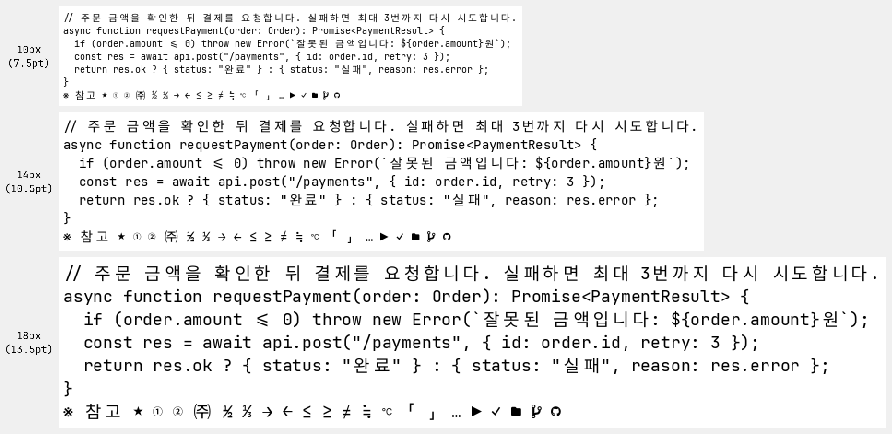
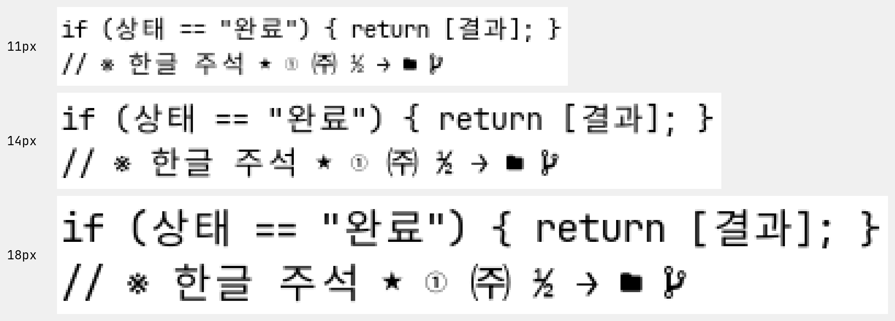

# Hangyeol Code (한결 코드)

Hangyeol Code is a monospaced coding font for Korean and English, tuned for Windows at
10–20 px. The name comes from the Korean *hangyeol-gatda*, "to stay the same throughout": its
core idea is that Hangul stays centered on the parentheses at every size.

Latin letters, ligatures and Nerd Font icons come from JetBrains Mono (Nerd Fonts), Hangul from
Pretendard, and the remaining KS X 1001 symbols from Pretendard and Noto Sans KR. Hangyeol Code
Narrow, the same font on cells 10% narrower, is built from the same sources in the same run.
Licensed under the SIL Open Font License 1.1.



*11, 14 and 18 px rendered with FreeType hinting, enlarged five times.*

[한국어](README.md)

## Features

- **Latin, ligatures and icons:** JetBrainsMono Nerd Font Mono as is, including its TrueType
  hinting.
- **Hangul:** Pretendard's Hangul on two Latin cells (1200 units).
  - Scaled by 1.08404 and moved down 25 units, which puts Hangul exactly on the top and bottom
    of `( )` as Windows renders them.
  - At 9–12 pt and 12–16 px, the height difference has a standard deviation of 0.03 px and the
    center difference 0.08 px.
- **Hangul hinting (10–20 px):** for each size and weight, all Hangul moves up or down by at
  most 1/8 px so that horizontal strokes land on pixel boundaries.
  - All Hangul moves together, so syllables never step against each other.
  - Sharpness improves by 0.8–4.4% at 11–20 px for Regular (a score weighted towards dark
    pixels). At 10 px there is no gain, so nothing moves.
- **Symbols:** all 988 KS X 1001 characters outside Hangul and Hanja.
  - What the Latin font lacks comes from Pretendard; the 197 characters Pretendard also lacks
    come from Noto Sans KR.
  - `⅓ ⅔ ⅛ ⅜ ⅝ ⅞ ≒`, which no source has or whose source design did not match, are built from
    JetBrains Mono parts. The fractions look like JetBrains Mono's own `½ ¼ ¾`.
- **Character widths:** follow Unicode East Asian Width. Wide characters take two cells and
  everything else one, so nothing overlaps in a terminal. Ambiguous characters such as
  `※ ★ ℃ ①` and half-width Hangul take one cell.
  - The build checks every character's width against this rule and warns about mismatches.
- **16 styles:** Thin, ExtraLight, Light, Regular, Medium, SemiBold, Bold, ExtraBold ×
  upright/italic. Hangul stays upright in the italics.
  - Windows apps such as Office list the weights as `Hangyeol Code Thin` and so on. Regular and
    Bold form `Hangyeol Code` itself, switched with the bold and italic buttons.

## Hangyeol Code Narrow

The same font with cells 10% narrower: 540 units for half-width and 1080 for full-width, with
the same line height. About 11% more characters fit on a line of the same width. Its version
always matches Hangyeol Code.



- **Position:** glyphs keep their place relative to the center of their cell; only glyphs that
  lean to one side and lack margin move a little.
- **Narrowing rules:**
  - A glyph that still has at least 7.5 units on both sides of the narrower cell only moves
    with its cell. All Hangul except half-width Hangul falls in this case.
  - Otherwise it first moves sideways by up to 20 units, at most until it is centered. Italics
    move as far as their upright glyphs; combining marks never move.
  - If it still does not fit, it is squeezed horizontally until 7.5 units are left, by at most
    10%.
  - Glyphs that already crossed their cell edges do not move and are squeezed by the full 10%.
  - Symbols drawn in a square, such as circled characters, shapes, stars and icons, are scaled
    vertically by the same factor.
  - Box drawing, blocks and Powerline separators are scaled by exactly 0.9 so they keep joining
    their neighbors.
- **Hinting:** the Latin hints only work vertically, so they stay. Latin shapes that were also
  scaled vertically (○ ■ ⊕ ...) follow their outlines as closely as before in FreeType at
  10–20 px.
  - Hangul, vertically scaled KS X 1001 symbols and icons each get their own 10–20 px shift
    table (`data/hints-narrow*.json`).
- **Name:** the family is `Hangyeol Code Narrow`, so it installs next to Hangyeol Code.

## Installation

Download `HangyeolCode-<version>.zip` from the
[releases](https://github.com/jaff2836/hangyeol-code/releases/latest). Install either the
single `HangyeolCode.ttc` or the 16 TTF files in `ttf/`, not both. Narrow comes the same way in
`HangyeolCodeNarrow-<version>.zip`.

- **Windows:** select the files, right-click → **Install for all users**.
- **macOS:** open the file and click **Install** in Font Book.
- **Linux:** copy the files to `~/.local/share/fonts` and run `fc-cache -f`.

**Windows Terminal** (`settings.json`)

```json
"font": { "face": "Hangyeol Code", "size": 11 }
```

**VS Code** (`settings.json`)

```json
"editor.fontFamily": "'Hangyeol Code'",
"editor.fontLigatures": true,
"terminal.integrated.fontFamily": "'Hangyeol Code'"
```

For Narrow, use `Hangyeol Code Narrow` instead of `Hangyeol Code`.

- The hints apply at 10–20 actual screen pixels.
  - 100% scaling: 8–15 pt, 10–20 px
  - 125% scaling: 6–12 pt, 8–16 px
- macOS does not use TrueType hinting.
- Windows Terminal and the VS Code terminal draw box drawing, blocks and Powerline symbols
  themselves instead of using the font (default settings).

**Web** — `HangyeolCode-webfont-<version>.zip` holds the 32 WOFF2 files of both families and two
CSS files (`hangyeolcode.css`, `hangyeolcodenarrow.css`). Put the files in one folder and link
the CSS.

```html
<link rel="stylesheet" href="hangyeolcode.css">
<style>
  code, pre { font-family: 'Hangyeol Code', monospace; }
</style>
```

Each WOFF2 is about 1.7 MB. Upload only the weights you use and drop the other `@font-face`
rules from the CSS to keep it light. Browsers download only the weights a page actually uses.

## Building

Requires [uv](https://docs.astral.sh/uv/) and `make`; uv fetches Python 3.12. The source fonts
are about 250 MB to download.

```bash
uv sync --all-groups
make download   # JetBrainsMono Nerd Font 3.5.1, Pretendard 1.3.9, Noto Sans KR 2.004
make run        # Hangyeol Code and Narrow: fonts/ttf/*.ttf, fonts/*.ttc
make test
make package    # release archives: dist/HangyeolCode-<version>.zip, -Narrow-, -webfont-
```

One build makes both families: each style is merged once and then finished as Hangyeol Code and
as Narrow. Pass `--families standard` or `--families narrow` to build only one. Building both
sets of 16 takes 5–10 minutes.

The defaults reproduce the released fonts. The downloaded sources (`upstream/`) and the outputs
(`fonts/`, `dist/`) are not committed. Source archives are checked against pinned SHA-256
hashes.

| Option | Default | Description |
|---|---|---|
| `--korean-scale` | `1.08404` | Hangul scale (after UPM normalization) |
| `--korean-y-offset` | `-25` | Hangul vertical shift (Latin font units, negative is down) |
| `--korean-hint-table` | `data/hints.json` | Per-size Hangul shift table, `""` for no hints |
| `--ksx-symbols` / `--no-ksx-symbols` | on | Add the KS X 1001 symbols |
| `--fallback-font` | `upstream/noto/NotoSansKR[wght].ttf` | Source of characters Pretendard lacks, `""` for Pretendard only |
| `--ttc` / `--no-ttc` | on | Also write a `.ttc` per family |
| `--webfonts` | off | Also write WOFF2 files and `@font-face` CSS |
| `--families` | `standard narrow` | Families to build |
| `--family-name` / `--narrow-family-name` | `Hangyeol Code` / `Hangyeol Code Narrow` | Family names |
| `--font-version` | package version (`1.001`) | Version written to the fonts (`MAJOR.MINOR`, `1.001` → `Version 1.001`) |
| `--variants` / `--weights` / `--styles` | all 16 | Build only some styles |
| `--narrow-ratio` | `0.9` | Narrow cell width ratio |
| `--narrow-min-margin` | `7.5` | Side margin kept before squeezing (font units) |
| `--narrow-max-shift` | `20` | Largest sideways move, before squeezing, of a glyph that does not fit between the margins (font units, at most until centered); `0` keeps glyphs in place |
| `--narrow-max-shrink` | `0.1` | Largest horizontal squeeze |
| `--narrow-hangul-hints` / `--narrow-symbols-hints` / `--narrow-icons-hints` | `data/hints-narrow*.json` | Narrow shift tables per group |
| `--no-hints` | off | Build both families without the shift hints |
| `--narrow-report` | none | Write a TSV of what happened to every Narrow glyph |

`make hints` builds the 8 upright styles once without hints and recomputes all four shift
tables (`data/hints.json`, `data/hints-narrow.json`, `-symbols`, `-icons`).

The package version uses the font's `MAJOR.MINOR` form (`1.001`). uv shows it as `1.1` under
PEP 440, but the fonts record `Version 1.001`.

### Releases

Pushing a tag named after the version in `pyproject.toml` (e.g. `v1.001`) makes GitHub Actions
download the sources, run the tests, build both families and create a draft release with three
archives (two of TTF and TTC, one of web fonts) and the `.ttc` files attached. `make package`
rebuilds the web fonts from the TTFs in `fonts/ttf` (`make webfonts`) before archiving.

### Windows ClearType rendering

`tools/render-windows` is a .NET 8 tool that renders the fonts with DirectWrite on Windows. It
loads the font files without installing them and sets the rendering parameters in code, so a CI
agent running as a service gets the same result regardless of the user's ClearType settings.

```bash
dotnet run --project tools/render-windows -c Release -- --fonts fonts/ttf --out renders
```

- Both families are drawn in ClearType (natural symmetric), grayscale and GDI classic at 11, 14
  and 18 px, as PNGs enlarged five times and at actual size (`-1x`) in `renders/`. DirectWrite
  applies the ligatures.
- The probe fonts in `tools/render-windows/probe/` (`scripts/make_hint_probe.py`) move one
  rectangle by known amounts (+1/8, +1/2, −1/8 px). How far DirectWrite really moves them, per
  mode, goes to `renders/probe.tsv`. With `--strict` the tool fails when any size moves against
  the instruction, or when the 10–20 px mean in a natural mode is off by more than half of it.
  It also fails when the uninstructed probe moves between grid fitting on and off, or when the
  probe folder or a probe font is missing.
- DirectWrite draws vertical edges in steps of about 1/4 px in the natural modes and whole pixels
  in GDI classic, so a 1/8 px shift shows up as 0, about 1/8 or 1/4 px depending on the size (0
  or 1 px in GDI classic).
- For Hangul, the difference of the ink centroids with grid fitting on and off is written next to
  the per-size shifts of `data/hints*.json` in `renders/hint-check.tsv`. The quantization also
  changes the thickness of thin strokes, which moves the centroid further, so this table is for
  reference; the probe fonts decide pass or fail.
- `renders/info.json` records the Windows and DirectWrite versions and the rendering parameters.
  DirectWrite output changes slightly between Windows builds, so keep it next to the images.
- `.buildkite/pipeline.yml` is an example that builds the fonts on a Linux agent and runs the tool
  on a Windows agent. Set the agent queues to your own and install the .NET 8 SDK or later on the
  Windows agent.

### Project layout

| Path | Contents |
|---|---|
| `src/hangyeol_code/builder.py` | Merging Latin, Hangul and symbols; character widths; names and version; per-size shift hints |
| `src/hangyeol_code/narrow.py` | Narrow conversion: per-glyph moves and squeezes, marks, ligatures and anchors, hint groups |
| `src/hangyeol_code/cli.py` | The `hangyeol-code` command: one merge per style, finished as both families |
| `scripts/compute_phase_hints.py` | Shift table computation (FreeType, `hints` dependency group) |
| `data/` | Shift tables (JSON) |
| `download_upstream.py` | Source font download (pinned versions and hashes) |
| `tests/` | Merge, CLI and Narrow tests |
| `.github/workflows/` | CI and releases |
| `assets/` | README images |
| `tools/render-windows/` | Windows DirectWrite rendering and Hangul hint check (.NET 8) |
| `.buildkite/` | Example pipeline for the Windows renders |

## How it is made

1. **Base:** JetBrainsMono Nerd Font Mono as is. Latin outlines and hinting instructions are
   byte-identical to the source.
2. **Hangul size and position:** JetBrains Mono does not hint `( )` vertically, so `( )` renders
   in proportion to its outline at every size, and one scale and offset match it at all sizes.
   - `[ ]` and `{ }` snap to pixels through the source hinting and move up to 0.7 px against
     `( )` from size to size. They are left as they are.
3. **Hangul hinting:** `scripts/compute_phase_hints.py` renders the Hangul of an unhinted build
   with FreeType, shifted up and down in steps of 1/64 px.
   - The score is `Σa³/Σa` (a is pixel coverage) over all 2,350 KS X 1001 Hangul syllables;
     darker pixels weigh more.
   - It picks the best position within ±1/8 px. That range keeps 61% of the gain of ±1/4 px
     while halving the offset from `( )`.
   - The builder writes the table into each Hangul glyph as per-size TrueType instructions
     (SHPIX). Windows DirectWrite moves them as intended.
4. **Symbols:** Noto Sans KR is where Pretendard's Hangul comes from (Source Han Sans).
   - It is aligned to Pretendard's coordinates through shared Hangul syllables (about 1 unit
     off), and for each weight the `wght` with the same Hangul stroke width is chosen. Stroke
     ratios are 0.98–1.01.
   - Symbols shrunk into one cell win back half of their stroke thinning from a heavier
     instance.
   - Circled numbers (①–⑮), `㈜`, `♡` and `♪` come from Noto Sans KR so that each set
     (circled characters, parenthesized Hangul, card suits, notes) is one design.
   - Fractions follow JetBrains Mono's `½`: numerator and denominator digits at 0.73 scale on a
     slash across the whole cell. Scaling thins the strokes, so the digits come from the
     weight two steps heavier.
   - `≒` is a composite of `=` and two periods, so each part keeps its hints. The dots sit as
     far from the bars as in `÷`.
5. **Character widths:** wide characters (W, F) take two cells and the rest one. Wide
   characters the source drew in one cell (`⚡` U+26A1, `﹢` U+FE62) move to the middle of two.
6. **Name table:** the copyright starts with Hangyeol Code, followed by the Pretendard and
   Noto Sans KR copyright and trademark notices. Manufacturer, designer and URLs are this
   project's, and weights other than Regular and Bold carry the weight in the family name
   (`Hangyeol Code Thin` / `Regular`).

## Known limitations

- Symbols fitted into one cell (`℃ ① ★` and so on) and half-width Hangul look small. In two
  cells they would overlap the next cell in a terminal.
- `♥` (U+2665) is the Octicons outline heart that Nerd Fonts put there.
- Conjoining medial and final Jamo (U+1161–11C2) are two cells wide: alone they are drawn as
  compatibility Jamo, and after an initial consonant ccmp joins them into a syllable.
  Terminals count them as zero cells. These characters are rarely used.
- `⅓ ⅔ ⅛ ⅜ ⅝ ⅞` are new outlines without TrueType hints and may look slightly softer than
  JetBrains Mono's `½ ¼ ¾` at small sizes.
- Hangul hinting moves whole glyphs, which does less than fitting each stroke. Per-stroke
  hinting with ttfautohint was tried and dropped because syllable heights differed by 1 px.
- In Narrow, glyphs that reach only one cell edge, such as `đ ħ ư ƒ`, still need a little
  squeezing after moving the full 20 units (`đ` to 0.94). A moved glyph sits that far off its
  plain counterpart, as `đ` against `d`. One-cell symbols (`① ★`) are a little smaller than in
  Hangyeol Code.

## Changelog

- **1.001** (2026-10-17, Narrow 2026-10-18)
  - Added Hangyeol Code Narrow, with cells 10% narrower.
  - Updated Nerd Fonts from 3.4.0 to 3.5.1: icons grew from 10,396 to 10,610, Braille
    patterns (U+2800–U+28FF, 256 characters) arrived, and `❬ ❭` changed shape.
  - Fixed about 600 Nerd Fonts icons drawn 1 unit (1/1000 em) left of the source. Their glyph
    headers had an xMin 1 unit off the outline, and recomputing xMin on save moved them. The
    left side bearings now move with it, so they render where the source draws them.
  - Added version information: `head.fontRevision` is 1.001, and name ID 5 also lists the
    source versions.
  - Covered all 988 KS X 1001 symbols: added `㉾` (added in KS X 1001:2002), built `⅔ ≒`, and
    changed `⅓ ⅛ ⅜ ⅝ ⅞` from Pretendard's design to the shape of `½`.
  - Half-width Hangul (U+FFA1–FFDC) went from two cells to one, and `⚡` (U+26A1) and `﹢`
    (U+FE62) from one cell to two.
  - Added a web font archive with WOFF2 files and CSS (`HangyeolCode-webfont-<version>.zip`).
  - Named weights other than Regular and Bold following the Windows rules, so apps such as
    Office can select every weight.
  - Changed manufacturer, designer, URLs and vendor ID from JetBrains to this project and put
    Hangyeol Code in the copyright. Dropped the Mac name records and FontForge's private
    `PfEd` table.
  - Hangul alignment and hinting values are the same as in 1.000.
- **1.000** (2026-10-17): first release.

## License

[SIL Open Font License 1.1](LICENSE). Hangyeol Code is a Modified Version of the sources below,
and not only the fonts but also the build scripts and documentation in this repository are
released under the same license. The build code comes from Jetendard and Yeomil Mono, both
released under the OFL.

- You are free to use the fonts, embed them in documents and bundle them with software. The
  fonts may not be sold by themselves.
- Modified versions must also be released under OFL 1.1 and include the copyright notices in
  [LICENSE](LICENSE).
- **Hangyeol Code declares no Reserved Font Name.** Modified versions may keep or change the
  name.
- Because of the sources' Reserved Font Names, a modified version may not use these words in
  its name: Jetendard, Yeomil Mono, Pretendard, Source, Inter, M PLUS 1.
- Trademarks: JetBrains Mono is a trademark of JetBrains s.r.o., Pretendard of Kil Hyung-jin,
  Inter of rsms, and Source of Adobe.
- The Nerd Fonts icon sets have their own licenses (Font Awesome and Codicons: CC BY 4.0;
  Material Design Icons: Apache 2.0; Octicons, Devicons and others: MIT, among others). See the
  [Nerd Fonts license audit](https://github.com/ryanoasis/nerd-fonts/blob/-/license-audit.md).

| Source | Version | Used for | License |
|---|---|---|---|
| [JetBrains Mono](https://github.com/JetBrains/JetBrainsMono) | 2.304 | Latin, ligatures, symbols, hinting | OFL 1.1 |
| [Nerd Fonts](https://github.com/ryanoasis/nerd-fonts) (JetBrainsMono NFM) | 3.5.1 | Icons, Braille patterns | OFL 1.1, per-icon-set licenses |
| [Pretendard](https://github.com/orioncactus/pretendard) | 1.3.9 | Hangul, symbols, kana | OFL 1.1 (RFN Pretendard) |
| [Noto Sans KR](https://fonts.google.com/noto/specimen/Noto+Sans+KR) (Source Han Sans) | 2.004 | Symbols Pretendard lacks, archaic Jamo | OFL 1.1 (RFN Source) |
| [Jetendard](https://github.com/kuskhan/jetendard) | 4b018fc | Build pipeline | OFL 1.1 (RFN Jetendard) |
| [Yeomil Mono](https://github.com/taevel02/yeomil-mono) | — | Structure Jetendard builds on | OFL 1.1 (RFN Yeomil Mono) |

Versions are the latest release of each source as of 2026-10-17.

- The JetBrains Mono repository has a 2.305 rebuilt in August 2024, but it is not a release,
  ships only unhinted variable fonts, and the latest Nerd Fonts still uses 2.304, so 2.304
  stays.
- Commits after Nerd Fonts 3.5.1 only touch the install script and the patcher's progress
  output; no glyph changed.
- Pretendard has had only source cleanups since 1.3.9, with no new font builds.
- Noto Sans KR matches the latest file in the google/fonts repository and is pinned by hash.

## Acknowledgements

This font is built on the build pipeline of [Jetendard](https://github.com/kuskhan/jetendard)
(Jung Woong Park), which in turn builds on the structure of
[Yeomil Mono](https://github.com/taevel02/yeomil-mono) (Taehoon Kwon). Thanks to the people
behind JetBrains Mono, Nerd Fonts, Pretendard, Source Han Sans and Noto Sans KR. These names
are given to credit the sources and do not mean that their authors endorse this font.
